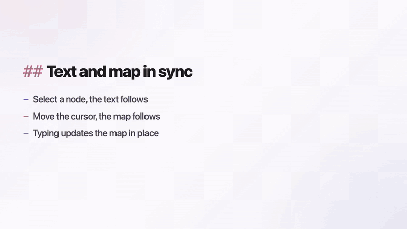
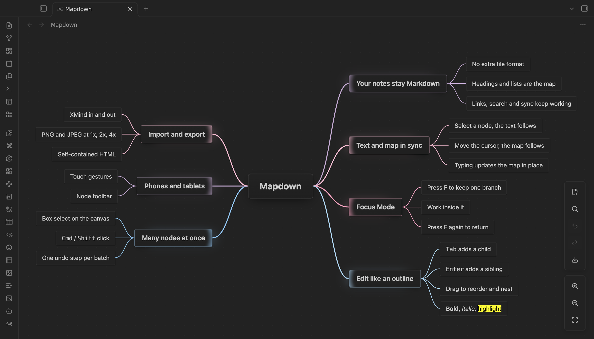
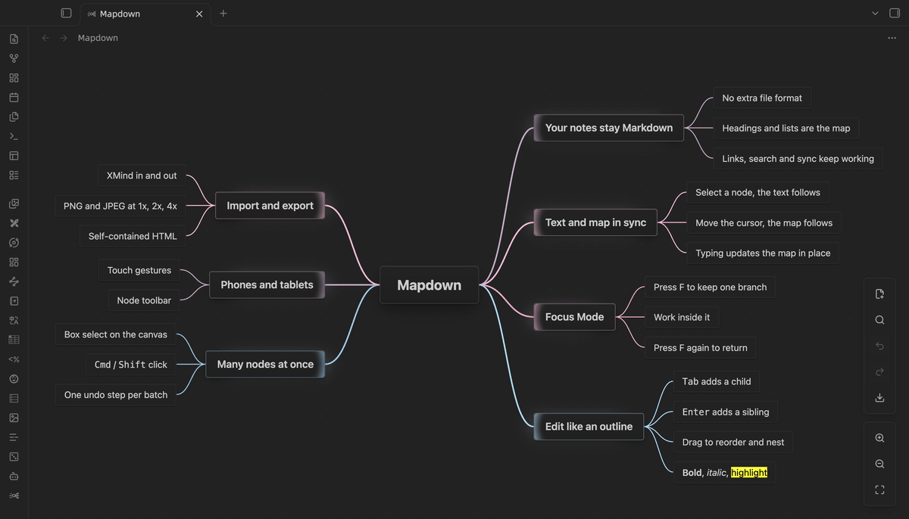
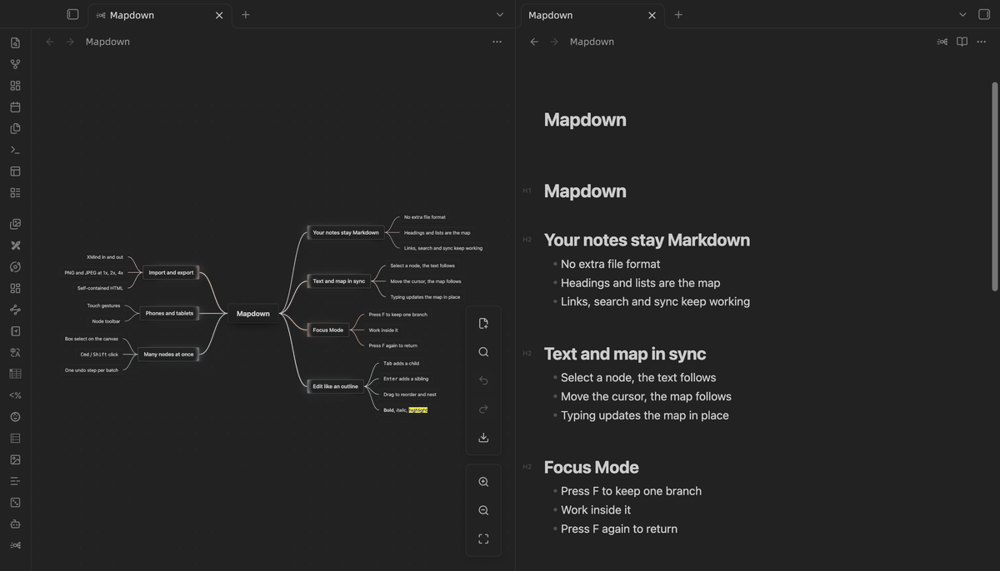
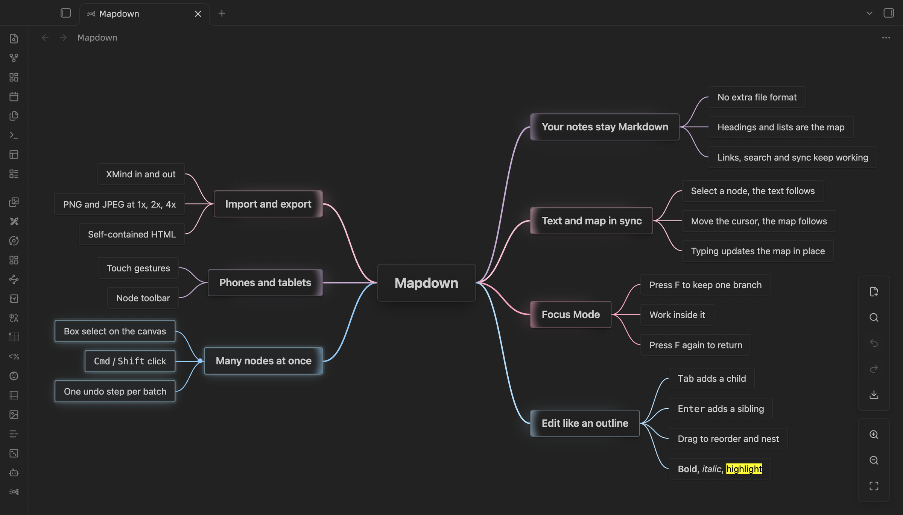

[中文说明](Readme-zh.md)

# Mapdown

**One Markdown note, two views.** Write in text, think in a mind map, and keep the two in sync.

Mapdown is an Obsidian plugin that opens your Markdown notes as editable mind maps. There is no separate file format: headings and lists are the map, and every edit in the map is saved back to the same `.md` file. It works on desktop, phones and tablets.



<!-- Launch film with sound: put the user-attachments link GitHub gives for mapdown-launch-720p.mp4 on its own line here. -->



## Why Mapdown

- **Your notes stay Markdown.** The map is just another view of the note. Links, search, sync and version history keep working.
- **Text and map stay in sync.** Open the note side by side: select a node and the Markdown jumps to its line; move the cursor in the text and the map follows.
- **Focus Mode.** Press `F` and the map shows only the selected branch, with the rest faded away. Work through one idea at a time, then press `F` again to get the whole map back, right where you left it.
- **Phones and tablets too.** Touch gestures and a node toolbar let you build and edit maps without a keyboard.
- **Built for Obsidian.** Nodes render Markdown, images and `[[wikilinks]]`, with hover previews.
- **Fast with big maps.** 1,000 nodes open in under 0.2 s; 5,000 stay smooth to pan and zoom.





## Quick start

1. Install and enable Mapdown.
2. Click the Mapdown icon in the ribbon or run **Create new mindmap**. To use a note you already have, click the Mapdown button next to the reading/editing toggle in its header.
3. To see text and map together, split the tab (right-click the tab → **Split right**) and run **Toggle markdown/mindmap** in one of the two panes.

A minimal mind map note:

```markdown
---
mindmap-plugin: basic
---

# Project plan

## Research
- Collect references
- Summarize findings

## Execution
- Draft outline
- Review milestones
```

When you open an ordinary note as a mind map, Mapdown asks first. You can convert the note, or save the map as a new note and leave the original untouched. Converting backs up the original text before the first save.

## Features

- **Keyboard-first editing:** `Tab`, `Enter`, arrow keys and `Space` build and edit the tree (see [Keys in the map](#keys-in-the-map)).
- **Drag and drop:** the map shows where a node will land before you let go. Hold `Ctrl` to copy.
- **Multiple selection:** `Cmd/Ctrl`-click, `Shift`-click or drag a box, then act on all of them in one undo step.
- **Paste an outline:** a multi-line list pasted into the map becomes a subtree.
- **Images:** paste, drag in, or run **Insert image…**.
- **Large maps:** collapse to any level with `Alt + 1…6`, search inside collapsed branches, and jump around with the overview on maps over 300 nodes.
- **XMind:** import `.xmind` files (XMind 2020+, Zen and XMind 8) as new notes, and export maps back to `.xmind`.
- **Export:** PNG and JPEG at 1x, 2x or 4x, or a self-contained HTML page.



## Keys in the map

These keys work only while the map has focus, so they never clash with your other hotkeys. `Mod` is `Cmd` on macOS and `Ctrl` elsewhere.

| Key | Action |
| --- | --- |
| `Tab` | Add a child node |
| `Enter` | Add a sibling node, or finish editing |
| `Shift + Tab` | Move the node up one level |
| `Space` / double-click | Edit the selected node |
| `Delete` / `Backspace` | Delete the selected nodes |
| Arrow keys | Move between nodes |
| `Alt + Shift` + arrow keys | Move the node up, down, left or right |
| `Home` | Select and center the root node |
| `F` | Toggle Focus Mode |
| `Esc` | Exit Focus Mode, cancel editing, or clear the selection |
| `Alt + 1…6` | Collapse the map to that level |
| `Mod + A` | Select all visible nodes |
| `Mod + C` / `X` / `V` | Copy, cut, paste nodes |
| `Mod + Z` / `Mod + Y` or `Mod + Shift + Z` | Undo / redo |
| `Alt + Shift + B` / `I` / `H` | Bold / italic / highlight |
| `Mod` + mouse wheel | Zoom |

Every action is also a command, so you can find it in the command palette and assign your own hotkey. Mapdown sets no global hotkeys.

## Settings

| Setting | What it does |
| --- | --- |
| Canvas size and background | Size and color of the map canvas |
| Heading levels | How many top levels are saved as Markdown headings; deeper nodes become list items |
| Font size | Base text size; each level scales from it |
| Node glow and maximum width | How selected nodes glow and where long text wraps |
| Layout direction | Both sides, right, left, or clockwise |
| Branch colors | Color preset for branches |
| Center after moving | Recenter on a node after it moves |
| Focus overlay and glow | How strongly Focus Mode dims the rest of the map |
| Link preview and open mode | Hover previews, and where clicked links open |
| Sync selection with Markdown | Turn the text–map selection sync on or off |

Changes apply to open maps right away, and every setting can be found with Obsidian's settings search.

## Limitations

- Mapdown structures notes; it is not a diagram tool. There are no themes, callouts or free-form drawing.
- XMind import and export are one-off conversions. Images, styles, summaries and relationships are not carried over.
- The interface is in English and Simplified Chinese.

## Privacy

Mapdown has no accounts, ads or telemetry, and never reads files outside your vault. It goes online only when you export a map that shows images from the web: those images are downloaded so they can be embedded in the PNG, JPEG or HTML file.

## Installation

### Community plugins

Once Mapdown is listed in the Obsidian community plugin directory:

1. Open **Settings → Community plugins**.
2. Search for `Mapdown`.
3. Install and enable it.

### BRAT

Add `leftlive/mapdown` in the BRAT plugin.

### Manual

1. Download `manifest.json`, `main.js` and `styles.css` from the latest GitHub release.
2. Put them in `.obsidian/plugins/mapdown` inside your vault.
3. Reload Obsidian and enable Mapdown under **Community plugins**.

Requires Obsidian 1.5.7 or later.

## Compatibility

- Mind maps saved by Enhancing Mindmap open in Mapdown unchanged: both use the `mindmap-plugin: basic` frontmatter.
- Mapdown was previously called MindMark. Maps made with MindMark open unchanged.
- Upgrading from Mapdown 0.3: your settings carry over. Save every open map before you upgrade, because unsaved recovery drafts from 0.3 are not read.

## Development

```bash
npm ci
npm run build
```

The build produces `main.js`; release files are `manifest.json`, `main.js` and `styles.css`.

## Acknowledgements

The idea of editing Markdown notes as mind maps in Obsidian was inspired by [Enhancing Mindmap](https://github.com/markmindckm/obsidian-enhancing-mindmap). Thanks to its author, Mark, for showing how well the two fit together.

## License

MIT. See [LICENSE.md](LICENSE.md).
