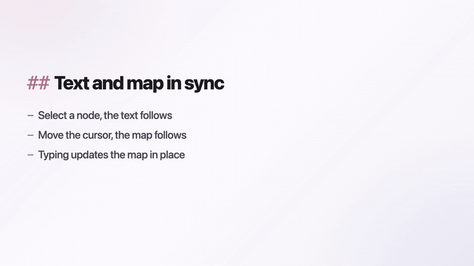
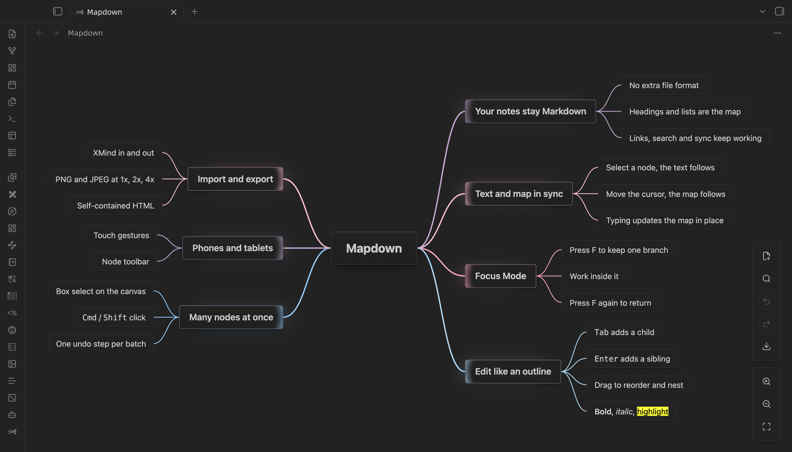
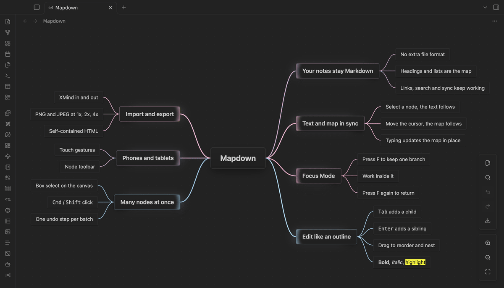
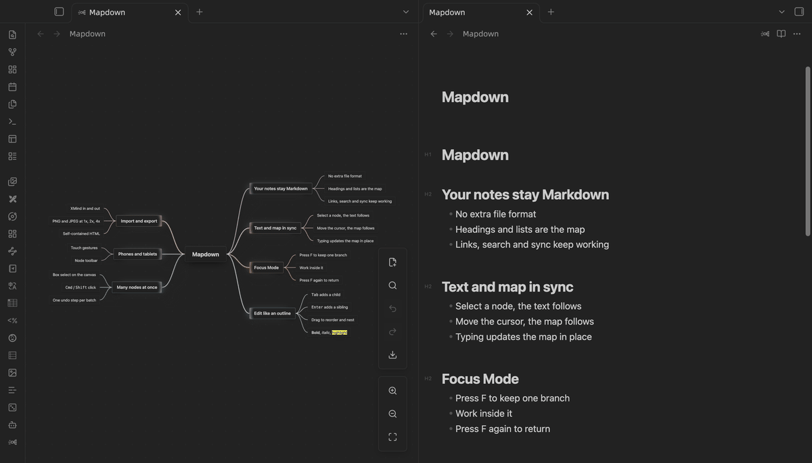
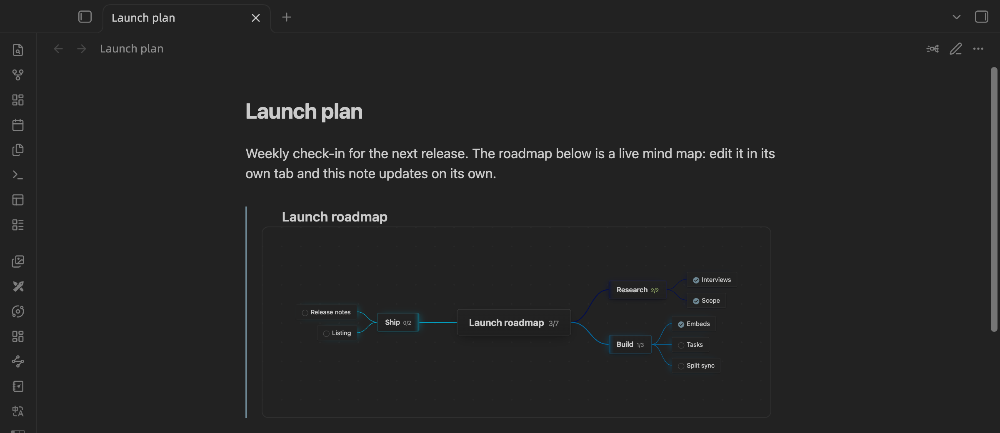
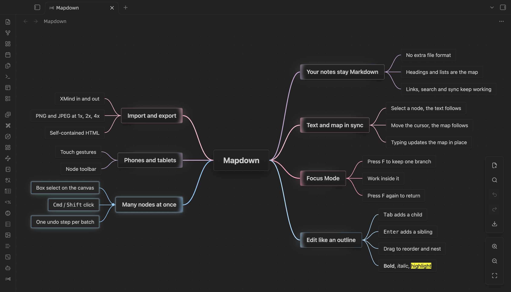

[English](README.md)


# Mapdown

**一篇 Markdown，两种看法。** 写作时用文本，整理时用导图，两边实时同步。

Mapdown 是一个 Obsidian 插件，把 Markdown 笔记作为可编辑的思维导图打开。它没有私有文件格式：标题和列表就是导图的结构，在导图里做的每一次修改都保存回同一个 `.md` 文件。电脑、手机和平板上都能用。



<!-- 带声音的宣传片：把 mapdown-launch-720p.mp4 上传后 GitHub 给的 user-attachments 链接单独一行放在这里。 -->



## 为什么用 Mapdown

- **笔记始终是 Markdown。** 导图只是同一篇笔记的另一种看法，双链、搜索、同步和版本历史照常工作。
- **文本和导图实时联动。** 点一下分屏按钮就能左右分屏打开同一篇笔记：选中节点，Markdown 跳到对应的行；在文本里移动光标，导图跟着选中。
- **把导图嵌进笔记。** 写 `![[某张导图]]`，或者右键选“插入导图…”，笔记里就出现一张能移动、能缩放的导图，跟着原导图实时更新。可以嵌入整张图，也可以只嵌入一个分支。
- **导图里的任务。** `- [ ]` 节点带复选框，上层节点显示 `2/5` 这样的完成进度。
- **概要和外框。** 用一个大括号给几个节点写一句概要，或者用虚线框圈出一个分支。两者都存成 `%%` 注释，笔记读起来还是普通的 Markdown。
- **拿导图来讲。** 全屏一支一支地讲，被问到时点任意节点跳过去，最后看全图。
- **专注模式。** 按 `F`，导图只留下选中的分支，其余部分淡出。一次只想一件事，想完再按一次 `F`，回到整张图，位置不变。
- **手机和平板也能用。** 触摸手势加上节点工具栏，不用键盘也能建图和编辑。
- **融入 Obsidian。** 节点里能显示 Markdown、图片和 `[[双链]]`，支持悬停预览。
- **大图也快。** 1,000 个节点不到 0.2 秒打开，5,000 个节点拖动和缩放依然流畅。







## 快速开始

1. 安装并启用 Mapdown。
2. 点左侧功能区的 Mapdown 图标，或者执行“创建新思维导图”。已有的笔记，点标题栏里阅读/编辑切换按钮旁边的 Mapdown 按钮。
3. 想同时看文本和导图：点导图标题栏里的分屏按钮，右边打开 Markdown，并打开联动选中；再点一下关掉。
4. 想在别的笔记里显示导图：在那篇笔记的编辑器里点右键，选“插入导图…”。

最简单的导图笔记：

```markdown
---
mindmap-plugin: basic
---

# 项目计划

## 调研
- 收集资料
- 整理结论

## 执行
- 写大纲
- 检查里程碑
```

把普通笔记打开为导图时，Mapdown 会先问你：可以直接转换这篇笔记，也可以另存为新导图、原笔记不动。直接转换时，第一次保存前会先备份原文。

## 功能

- **键盘编辑**：`Tab`、`Enter`、方向键和`空格`就能建树和编辑，见[导图里的按键](#导图里的按键)。
- **拖动**：松手前就能看到节点会落在哪里。按住 `Ctrl` 是复制。
- **多选**：`Cmd/Ctrl` 点选、`Shift` 点选或拖出选框。选区上方的操作条可以一次设为任务、加粗、高亮、设为引用、加标记、加概要和外框、折叠、复制、剪切或删除，只算一步撤销。
- **嵌入导图**：阅读视图和实时预览里，`![[导图]]` 显示成导图；`![[导图#标题]]` 只显示一个分支，`![[导图|300]]` 设置高度。点一下就能移动和缩放，双击节点打开导图并定位到它。导图节点里嵌入的导图显示成卡片，点一下打开。
- **任务**：点复选框或按 `Mod + Enter` 勾选任务，上层节点统计下面的任务。
- **标记**：用标记面板（`M`）在节点前面加优先级、颜色和 ⭐、❓ 这样的符号。标记就是文字里的 emoji，XMind 导入导出时对应 XMind 的图标。
- **概要和外框**：`S` 在选中的同级节点后面加一个概要，用大括号括住；`B` 给节点和它的分支加上外框，可以带标签。所有导出、白板和 XMind 里都有。
- **Markdown 视图里**：导图笔记在列表旁边用细线标出概要和外框的范围，外框标签显示成小标签，导图的属性合成一行，块 id 隐藏。
- **引用和 callout**：节点里的显示效果和阅读视图一样。“切换引用”把节点变成引用，再执行一次变回来。
- **数学公式**：节点里能显示行内 `$…$` 和块级 `$$…$$` 公式，块级公式可以写成多行。
- **分支配色样式**：分支颜色除了画在连线上，还可以画在节点边框上，或者给节点铺一层淡底色，越往外越淡。
- **布局方向**：两侧、右侧、左侧、顺时针，或者像组织结构图一样向下。每张导图有自己的方向，在工具栏里设置。
- **粘贴大纲**：多行列表粘贴进导图，直接变成子树。
- **图片**：粘贴、拖入，或者执行“插入图片…”。
- **大图**：`Alt + 1…6` 折叠到任意层级，搜索覆盖折叠的分支，超过 300 个节点时有缩略总览。
- **XMind**：把 `.xmind` 文件（XMind 2020 以后、Zen 和 XMind 8）导入成新笔记，也能把导图导出为 `.xmind`。
- **导出**：1x、2x、4x 的 PNG 和 JPEG，SVG、PDF，或者一个可以离线打开的 HTML。电脑上默认每次询问保存位置，导出完成后有提示。
- **白板**：把导图导出成 Obsidian 白板，每个节点一张卡片，之后在白板里继续摆放。



## 导图里的按键

这些按键只在导图获得焦点时生效，不会和你的其他快捷键冲突。`Mod` 在 macOS 上是 `Cmd`，在其他系统上是 `Ctrl`。

| 按键 | 作用 |
| --- | --- |
| `Tab` | 新增子节点 |
| `Enter` | 新增同级节点，或结束编辑 |
| `Shift + Enter` / `Mod + Enter` | 编辑时在节点里换行 |
| `Shift + Tab` | 节点升一级 |
| `空格` / 双击 | 编辑选中的节点 |
| `Delete` / `Backspace` | 删除选中的节点 |
| `Mod + Enter` | 把选中的节点设为任务，或勾上 / 取消勾选 |
| `M` | 打开标记面板 |
| `S` | 在选中的节点后面加一个概要 |
| `B` | 加上或去掉外框 |
| 方向键 | 在节点之间移动 |
| `Alt + Shift` + 方向键 | 节点上移、下移、左移、右移 |
| `Home` | 选中根节点并居中 |
| `F` | 进入或退出专注模式 |
| `Esc` | 退出专注模式、取消编辑或取消选中 |
| `Alt + 1…6` | 整张图折叠到第几层 |
| `Mod + A` | 选中所有可见节点 |
| `Mod + C` / `X` / `V` | 复制、剪切、粘贴节点 |
| `Mod + Z` / `Mod + Y` 或 `Mod + Shift + Z` | 撤销 / 重做 |
| `Alt + Shift + B` / `I` / `H` | 加粗 / 斜体 / 高亮 |
| `Mod` + 滚轮 | 缩放 |

每个操作都是一条命令，可以在命令面板里搜到，也可以自己绑快捷键。Mapdown 不占用任何全局快捷键。

## 设置

| 设置 | 作用 |
| --- | --- |
| 画布大小和背景 | 导图画布的尺寸和颜色 |
| 标题层级 | 前几层保存为 Markdown 标题，更深的层级保存为列表 |
| 字号 | 基础字号，各层级按比例放大或缩小 |
| 节点光晕和最大宽度 | 选中节点的光晕，以及长文字在哪里换行 |
| 默认布局方向 | 两侧、右侧、左侧、顺时针或向下，用于没有单独设置方向的导图 |
| 分支配色 | 分支颜色的预设 |
| 分支配色样式 | 只有连线、边框，或者淡底色 |
| 移动后居中 | 节点移动后让它居中 |
| 专注模式的遮罩和光晕 | 专注模式下其余部分淡化的程度 |
| 链接预览和打开方式 | 悬停预览，以及点击链接后在哪里打开 |
| 与 Markdown 联动选中 | 打开或关闭文本和导图的联动 |
| 显示任务进度 | 在下面有任务的节点上显示“完成数/总数” |
| 嵌入导图和高度 | `![[导图]]` 是否显示成导图，以及它的高度 |
| 在 Markdown 里整理导图笔记 | Markdown 视图里显示范围线和外框标签，把导图属性合成一行 |
| 导出位置 | 每次询问保存位置，或者存到笔记旁边 |

改动立即作用于已经打开的导图，每个设置项都能用 Obsidian 的设置搜索找到。

## 已知限制

- Mapdown 用来整理笔记结构，不是制图工具，没有主题模板、关联线和自由绘制。
- XMind 导入导出是一次性转换，图片、样式、关联线和框住多个主题的外框不会带过来。
- 导出的 PNG、JPEG、SVG 和 PDF 里，公式显示为源码。PDF 是一页高清图片，里面的文字不能选中。
- 手机和平板上，导出的文件总是存到笔记旁边。
- 界面语言只有英文和简体中文。

## 隐私

Mapdown 没有账号、广告和遥测，也不读取库以外的文件。只有一种情况会联网：导出的导图里有来自网络的图片时，会下载这些图片，嵌进导出的文件。

## 安装

### 社区插件

Mapdown 上架 Obsidian 社区插件目录后：

1. 打开“设置 → 第三方插件”。
2. 搜索 `Mapdown`。
3. 安装并启用。

### BRAT

在 BRAT 插件里添加 `leftlive/mapdown`。

### 手动安装

1. 从 GitHub 最新的 Release 下载 `manifest.json`、`main.js` 和 `styles.css`。
2. 放进库里的 `.obsidian/plugins/mapdown` 文件夹。
3. 重新载入 Obsidian，在“第三方插件”里启用 Mapdown。

需要 Obsidian 1.8.7 及以上。

## 兼容性

- 用 Enhancing Mindmap 保存的导图可以直接打开，不需要转换：两者都用 `mindmap-plugin: basic` 这个 frontmatter。
- Mapdown 以前叫 MindMark，用 MindMark 做的导图照常打开。
- 从 Mapdown 0.3 升级：设置会沿用。升级前请保存所有打开的导图，0.3 留下的未保存恢复草稿不会被读取。

## 开发

```bash
npm ci
npm run build
```

构建产物是 `main.js`，发布文件是 `manifest.json`、`main.js` 和 `styles.css`。

## 致谢

在 Obsidian 里把 Markdown 笔记当作导图来编辑，这个思路参考了 [Enhancing Mindmap](https://github.com/markmindckm/obsidian-enhancing-mindmap)。感谢原作者 Mark，是他先让人看到导图和 Markdown 可以这样结合。

## 许可

MIT，见 [LICENSE.md](LICENSE.md)。
